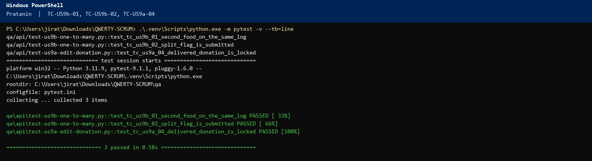
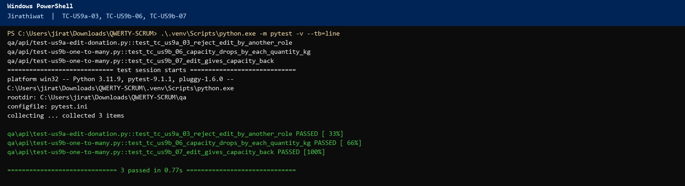
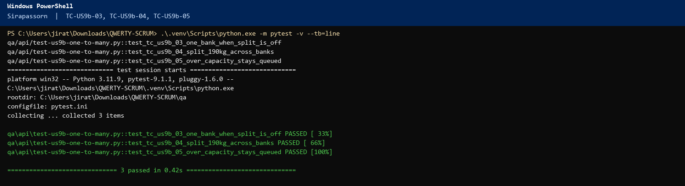
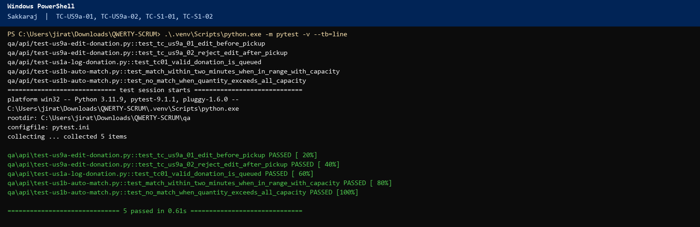

# Sprint 2 – Scrum Meeting 3 Script (QWERTY)

Friday 6 November 2026. Sprint Day 3. Three-question format.

## Meeting at a glance

Today is **Sprint Day 3**. This standup does **not** report Days 3–4 as finished. Days 1–2 are finished (14 hours). Day 3 starts after this meeting.

The instructor asked that, from this meeting on, **each person answers “What will I do next?” with test cases**: number, name, and expected output. Those rows live in `docs/sprint-2-tdd-report.md` and `docs/sprint-2-tdd-report.docx`. Write the test first (Red). Code comes after (Green). Each case below includes the command. Start the site (`cd web`, then `npm run dev`) and run the command from the repo root.

| Item | Detail |
|---|---|
| Date | Friday 6 November 2026 (Sprint Day 3) |
| Length | About 15 minutes |
| Facilitator | Napat Tayommai (Scrum Master) |
| Reports | Days 1–2, **14 hours**. US9a form and PATCH are In Review. US9a QA and all of US9b are still To-Do. |
| Next | Days 3–4, **18 hours**, spoken as test cases. Monday 9 November is Meeting 4. |
| Three questions | 1. What did I accomplish since Wednesday? 2. What will I do next? (test cases) 3. Blockers? |

## Before the meeting

1. Open `docs/sprint-2-tdd-report.docx` on the screen.
2. Do not say the multi-food form, `proposeMatches`, or US9a QA are finished. Those hours are today and Saturday (Days 3–4).
3. Demo base only: http://localhost:3000

---

## The script

### 1. Opening (Napat, about 1 minute)

Good morning. This is Scrum meeting **three**, **Friday 6 November**, Sprint **Day 3**. Wednesday we finished Days 1 and 2: the edit form and `PATCH /api/donations/:id`, both In Review. We have not started Day 3.

From today, “What will I do next?” is not a task name. It is the **test cases** you will write or run before you code. Number, name, expected output. The sheet we hand in with the final presentation is the TDD report. Red means the test is not passing yet. Green means it passed. Yellow means it is specified and waiting for today’s run.

Pratanin, please start.

### 2. Pratanin, Dev 1 (about 2 minutes)

**Accomplished:** **US9a Build donor edit form** is **6 of 6 hours** from Days 1–2 and **In Review**. Edit shows only while the donation is queued or matched.

**Next:** I will not code the multi-food form until these cases are written. They are Days 3–4, **6 hours**.

- **TC-US9b-01** Add a second food. Expected: one `donationId`, `lines` length 2, `quantity` equals the sum of the lines.

  `.\.venv\Scripts\python.exe -m pytest qa/api/test-us9b-one-to-many.py::test_tc_us9b_01_second_food_on_the_same_log -q`

- **TC-US9b-02** Tick “send this log to more than one food bank.” Expected: the POST body has `splitAcrossBanks: true`.

  `.\.venv\Scripts\python.exe -m pytest qa/api/test-us9b-one-to-many.py::test_tc_us9b_02_split_flag_is_submitted -q`

- **TC-US9a-04** Open a delivered donation. Expected: the list says Locked and there is no Edit link.

  `.\.venv\Scripts\python.exe -m pytest qa/api/test-us9a-edit-donation.py::test_tc_us9a_04_delivered_donation_is_locked -q`

All three passed. The terminal picture below shows PASSED for TC-US9b-01, TC-US9b-02, and TC-US9a-04.

**Blockers:** None.

### 3. Napat to Jirathiwat

Thanks, Pratanin. Jirathiwat, you're next.

### 4. Jirathiwat, Dev 3 (about 2 minutes)

**Accomplished:** **US9a PATCH /api/donations/:id** is **8 of 8 hours** from Days 1–2 and **In Review**. I have **0 hours** on Day 3. I do not start capacity until Day 5.

**Next:** I write the failing tests before Day 5, so the code has something to pass.

- **TC-US9a-03** A food bank calls PATCH. Expected: **403**.

  `.\.venv\Scripts\python.exe -m pytest qa/api/test-us9a-edit-donation.py::test_tc_us9a_03_reject_edit_by_another_role -q`

- **TC-US9b-06** A 190 kg split is saved. Expected: SOS `remainingCapacityKg` falls by **164**, not by 190.

  `.\.venv\Scripts\python.exe -m pytest qa/api/test-us9b-one-to-many.py::test_tc_us9b_06_capacity_drops_by_each_quantity_kg -q`

- **TC-US9b-07** The donor edits that log. Expected: the old kilograms are restored, then the new match subtracts only the new `quantityKg`.

  `.\.venv\Scripts\python.exe -m pytest qa/api/test-us9b-one-to-many.py::test_tc_us9b_07_edit_gives_capacity_back -q`

All three passed. The terminal picture below shows PASSED for TC-US9a-03, TC-US9b-06, and TC-US9b-07.

**Blockers:** None.

### 5. Napat to Sirapassorn

Thanks, Jirathiwat. Sirapassorn, name the card and the tests.

### 6. Sirapassorn, Dev 2 (about 2 minutes)

**Accomplished:** **0 hours** since Wednesday, as planned. `proposeMatch` is still the Sprint 1 one-bank path.

**Next:** Days 3–4 are **US9b proposeMatches**, **8 hours**. I write these tests first.

- **TC-US9b-03** `splitAcrossBanks` false, quantity 10. Expected: one match, `status` matched.

  `.\.venv\Scripts\python.exe -m pytest qa/api/test-us9b-one-to-many.py::test_tc_us9b_03_one_bank_when_split_is_off -q`

- **TC-US9b-04** Two lines, 100 kg and 90 kg, split true. Expected: at least two matches, sum of `quantityKg` is **190**.

  `.\.venv\Scripts\python.exe -m pytest qa/api/test-us9b-one-to-many.py::test_tc_us9b_04_split_190kg_across_banks -q`

- **TC-US9b-05** Quantity 4000. Expected: `match` is null, `status` queued.

  `.\.venv\Scripts\python.exe -m pytest qa/api/test-us9b-one-to-many.py::test_tc_us9b_05_over_capacity_stays_queued -q`

All three passed. The terminal picture below shows PASSED for TC-US9b-03, TC-US9b-04, and TC-US9b-05.

**Blockers:** None.

### 7. Napat to Sakkaraj

Thank you, Sirapassorn. Sakkaraj.

### 8. Sakkaraj, QA 1 (about 2 minutes)

**Accomplished:** **0 hours** on Days 1–2. US9a is not Done. I have not ticked the QA card.

**Next:** Days 3–4 are **US9a QA**, **4 hours**. These are the cases I run.

- **TC-US9a-01** Donor PATCH, Bakery 4 kg to Dairy 6 kg. Expected: **200**, `foodType` Dairy, `quantity` 6, `lines[0].foodType` Dairy.

  `.\.venv\Scripts\python.exe -m pytest qa/api/test-us9a-edit-donation.py::test_tc_us9a_01_edit_before_pickup -q`

- **TC-US9a-02** Same donation after pickup. Expected: **409**.

  `.\.venv\Scripts\python.exe -m pytest qa/api/test-us9a-edit-donation.py::test_tc_us9a_02_reject_edit_after_pickup -q`

- **TC-S1-01** Sprint 1 regression. Expected: queue under 60 seconds.

  `.\.venv\Scripts\python.exe -m pytest qa/api/test-us1a-log-donation.py::test_tc01_valid_donation_is_queued -q`

- **TC-S1-02** Sprint 1 regression. Expected: match under 120 seconds, and quantity 4000 stays queued.

  `.\.venv\Scripts\python.exe -m pytest qa/api/test-us1b-auto-match.py::test_match_within_two_minutes_when_in_range_with_capacity -q`

  `.\.venv\Scripts\python.exe -m pytest qa/api/test-us1b-auto-match.py::test_no_match_when_quantity_exceeds_all_capacity -q`

TC-US9a-01, TC-US9a-02, TC-S1-01, and TC-S1-02 passed. The terminal picture below shows those five PASSED lines. TC-S1-02 is the two match tests: in range under 120 seconds, and quantity 4000 stays queued.

**Blockers:** None, if `POST /api/test/reset` still restores SOS to 164 kg.

### 9. Napat's own update (about 1 minute)

**Accomplished:** Days 1–2 are **14 of 113**. The board is still the Wednesday board. Day 3 hours are not logged.

**Next:** I own the TDD report. Before Monday I will set today’s rows:

- **TC-RPT-01** Every new case has a number, a name, an owner, and an expected output. Expected: no blank row in the report. No pytest command. This is a report check.
- **TC-RPT-02** A card does not move to Done while its cases are Red. Expected: US9a and US9b stay In Review or To-Do on Monday if any case is still Red. No pytest command. This is a report check.

**Blockers:** None.

### 10. Blocker and risk review (Napat, about 1 minute)

The pictures match the cases just named. TC-US9a-02 and TC-US9b-06 both show PASSED. Does anyone see a case in the script that is missing from their picture?

### 11. Definition of Done check (Napat, about 1 minute)

The Day 3 cases on the screen are Green. US9a stays In Review until the hours are on the sheet. US9b stays To-Do until Monday logs Days 3–4.

### 12. Closing (Napat, about 30 seconds)

Day 3 starts now. Next standup is **Monday 9 November, 09:00**, Meeting 4. Bring the TDD report. Thank you.

---

## Test cases this meeting calls “next”

| Who | Cases | Cycle this morning |
|---|---|---|
| Pratanin | TC-US9b-01, TC-US9b-02, TC-US9a-04 | Green, 3 passed |
| Jirathiwat | TC-US9a-03, TC-US9b-06, TC-US9b-07 | Green, 3 passed |
| Sirapassorn | TC-US9b-03, TC-US9b-04, TC-US9b-05 | Green, 3 passed |
| Sakkaraj | TC-US9a-01, TC-US9a-02, TC-S1-01, TC-S1-02 | Green, 5 passed |
| Napat | TC-RPT-01, TC-RPT-02 | Report rows match the pictures |

## Card positions after this meeting

| Card | Owner | Column |
|---|---|---|
| US9a edit form (6/6) | Pratanin | In Review |
| US9a PATCH (8/8) | Jirathiwat | In Review |
| US9a QA (0/4) | Sakkaraj | To-Do |
| US9b lines, proposeMatches, capacity, QA | team | To-Do |
| US3b and later | — | To-Do |

## Terminal evidence

Run on Friday 6 November 2026 against http://localhost:3000. The picture is the terminal. The code under it is the test that produced that result.

### Pratanin

Command for each case in this picture:

`.\.venv\Scripts\python.exe -m pytest qa/api/test-us9b-one-to-many.py::test_tc_us9b_01_second_food_on_the_same_log -q`

`.\.venv\Scripts\python.exe -m pytest qa/api/test-us9b-one-to-many.py::test_tc_us9b_02_split_flag_is_submitted -q`

`.\.venv\Scripts\python.exe -m pytest qa/api/test-us9a-edit-donation.py::test_tc_us9a_04_delivered_donation_is_locked -q`

The picture is one run of those same tests:

`.\.venv\Scripts\python.exe -m pytest -v --tb=line qa/api/test-us9b-one-to-many.py::test_tc_us9b_01_second_food_on_the_same_log qa/api/test-us9b-one-to-many.py::test_tc_us9b_02_split_flag_is_submitted qa/api/test-us9a-edit-donation.py::test_tc_us9a_04_delivered_donation_is_locked`


```python
def test_tc_us9b_01_second_food_on_the_same_log():
    response = donor().post(f"{BASE_URL}/api/donations", json=_split_payload(), timeout=10)
    assert response.status_code == 201, response.text
    donation = response.json()["donation"]
    assert len(donation["lines"]) == 2
    assert donation["quantity"] == 190

def test_tc_us9b_02_split_flag_is_submitted():
    response = donor().post(f"{BASE_URL}/api/donations", json=_split_payload(), timeout=10)
    assert response.status_code == 201, response.text
    assert response.json()["donation"]["splitAcrossBanks"] is True

def test_tc_us9a_04_delivered_donation_is_locked():
    donation_id = create_donation(donor(), quantity=4)["donation"]["donationId"]
    driver_session = driver()
    assert driver_session.post(f"{BASE_URL}/api/pickup", json={"donationId": donation_id}, timeout=10).status_code == 200
    delivered = driver_session.post(
        f"{BASE_URL}/api/delivery",
        json={"donationId": donation_id, "proofKind": "signature", "proofDataUrl": PROOF},
        timeout=10,
    )
    assert delivered.status_code == 200, delivered.text
    assert delivered.json()["donation"]["status"] == "delivered"
    listed = donor().get(f"{BASE_URL}/api/donations", timeout=10).json()["donations"]
    row = next(item for item in listed if item["donationId"] == donation_id)
    assert row["status"] == "delivered"
```

### Jirathiwat

Command for each case in this picture:

`.\.venv\Scripts\python.exe -m pytest qa/api/test-us9a-edit-donation.py::test_tc_us9a_03_reject_edit_by_another_role -q`

`.\.venv\Scripts\python.exe -m pytest qa/api/test-us9b-one-to-many.py::test_tc_us9b_06_capacity_drops_by_each_quantity_kg -q`

`.\.venv\Scripts\python.exe -m pytest qa/api/test-us9b-one-to-many.py::test_tc_us9b_07_edit_gives_capacity_back -q`

The picture is one run of those same tests:

`.\.venv\Scripts\python.exe -m pytest -v --tb=line qa/api/test-us9a-edit-donation.py::test_tc_us9a_03_reject_edit_by_another_role qa/api/test-us9b-one-to-many.py::test_tc_us9b_06_capacity_drops_by_each_quantity_kg qa/api/test-us9b-one-to-many.py::test_tc_us9b_07_edit_gives_capacity_back`


```python
def test_tc_us9a_03_reject_edit_by_another_role():
    donation_id = create_donation(donor(), quantity=4)["donation"]["donationId"]
    edited = foodbank().patch(
        f"{BASE_URL}/api/donations/{donation_id}",
        json={
            "lines": [{"foodType": "Dairy", "quantity": 4, "expiryDateTime": future_expiry(240)}],
            "splitAcrossBanks": False,
        },
        timeout=10,
    )
    assert edited.status_code == 403, edited.text

def test_tc_us9b_06_capacity_drops_by_each_quantity_kg():
    session = _fresh()
    before = next(item for item in session.get(f"{BASE_URL}/api/food-banks", timeout=10).json()["foodBanks"] if item["id"] == "fb-sos-bkk")
    created = donor().post(f"{BASE_URL}/api/donations", json=_split_payload(), timeout=10)
    assert created.status_code == 201, created.text
    sos_share = next(item["quantityKg"] for item in created.json()["matches"] if item["foodBankId"] == "fb-sos-bkk")
    after = next(item for item in foodbank().get(f"{BASE_URL}/api/food-banks", timeout=10).json()["foodBanks"] if item["id"] == "fb-sos-bkk")
    assert sos_share == 164
    assert round(before["remainingCapacityKg"] - after["remainingCapacityKg"], 2) == 164

def test_tc_us9b_07_edit_gives_capacity_back():
    session = _fresh()
    owner = donor()
    created = owner.post(f"{BASE_URL}/api/donations", json=_split_payload(), timeout=10)
    assert created.status_code == 201, created.text
    donation_id = created.json()["donation"]["donationId"]
    edited = owner.patch(
        f"{BASE_URL}/api/donations/{donation_id}",
        json={
            "lines": [{"foodType": "Dairy", "quantity": 10, "expiryDateTime": future_expiry(240)}],
            "pickupWindow": created.json()["donation"]["pickupWindow"],
            "splitAcrossBanks": False,
        },
        timeout=10,
    )
    assert edited.status_code == 200, edited.text
    sos = next(item for item in session.get(f"{BASE_URL}/api/food-banks", timeout=10).json()["foodBanks"] if item["id"] == "fb-sos-bkk")
    assert sos["remainingCapacityKg"] == 154
```

### Sirapassorn

Command for each case in this picture:

`.\.venv\Scripts\python.exe -m pytest qa/api/test-us9b-one-to-many.py::test_tc_us9b_03_one_bank_when_split_is_off -q`

`.\.venv\Scripts\python.exe -m pytest qa/api/test-us9b-one-to-many.py::test_tc_us9b_04_split_190kg_across_banks -q`

`.\.venv\Scripts\python.exe -m pytest qa/api/test-us9b-one-to-many.py::test_tc_us9b_05_over_capacity_stays_queued -q`

The picture is one run of those same tests:

`.\.venv\Scripts\python.exe -m pytest -v --tb=line qa/api/test-us9b-one-to-many.py::test_tc_us9b_03_one_bank_when_split_is_off qa/api/test-us9b-one-to-many.py::test_tc_us9b_04_split_190kg_across_banks qa/api/test-us9b-one-to-many.py::test_tc_us9b_05_over_capacity_stays_queued`


```python
def test_tc_us9b_03_one_bank_when_split_is_off():
    body = create_donation(donor(), quantity=10)
    assert body["match"] is not None
    assert len(body["matches"]) == 1
    assert body["donation"]["status"] == "matched"

def test_tc_us9b_04_split_190kg_across_banks():
    _fresh()
    response = donor().post(f"{BASE_URL}/api/donations", json=_split_payload(), timeout=10)
    assert response.status_code == 201, response.text
    body = response.json()
    assert len(body["matches"]) >= 2
    assert sum(item["quantityKg"] for item in body["matches"]) == 190

def test_tc_us9b_05_over_capacity_stays_queued():
    body = create_donation(donor(), quantity=4000)
    assert body["match"] is None
    assert body["donation"]["status"] == "queued"
```

### Sakkaraj

Command for each case in this picture:

`.\.venv\Scripts\python.exe -m pytest qa/api/test-us9a-edit-donation.py::test_tc_us9a_01_edit_before_pickup -q`

`.\.venv\Scripts\python.exe -m pytest qa/api/test-us9a-edit-donation.py::test_tc_us9a_02_reject_edit_after_pickup -q`

`.\.venv\Scripts\python.exe -m pytest qa/api/test-us1a-log-donation.py::test_tc01_valid_donation_is_queued -q`

`.\.venv\Scripts\python.exe -m pytest qa/api/test-us1b-auto-match.py::test_match_within_two_minutes_when_in_range_with_capacity -q`

`.\.venv\Scripts\python.exe -m pytest qa/api/test-us1b-auto-match.py::test_no_match_when_quantity_exceeds_all_capacity -q`

The picture is one run of those same tests:

`.\.venv\Scripts\python.exe -m pytest -v --tb=line qa/api/test-us9a-edit-donation.py::test_tc_us9a_01_edit_before_pickup qa/api/test-us9a-edit-donation.py::test_tc_us9a_02_reject_edit_after_pickup qa/api/test-us1a-log-donation.py::test_tc01_valid_donation_is_queued qa/api/test-us1b-auto-match.py::test_match_within_two_minutes_when_in_range_with_capacity qa/api/test-us1b-auto-match.py::test_no_match_when_quantity_exceeds_all_capacity`


```python
def test_tc_us9a_01_edit_before_pickup():
    session = donor()
    created = create_donation(session, foodType="Bakery", quantity=4)
    donation_id = created["donation"]["donationId"]
    edited = session.patch(
        f"{BASE_URL}/api/donations/{donation_id}",
        json={
            "lines": [{"foodType": "Dairy", "quantity": 6, "expiryDateTime": future_expiry(240)}],
            "pickupWindow": created["donation"]["pickupWindow"],
            "splitAcrossBanks": False,
        },
        timeout=10,
    )
    assert edited.status_code == 200, edited.text
    body = edited.json()["donation"]
    assert body["foodType"] == "Dairy"
    assert body["quantity"] == 6
    assert body["lines"][0]["foodType"] == "Dairy"

def test_tc_us9a_02_reject_edit_after_pickup():
    session = donor()
    donation_id = create_donation(session, quantity=5)["donation"]["donationId"]
    assert driver().post(f"{BASE_URL}/api/pickup", json={"donationId": donation_id}, timeout=10).status_code == 200
    edited = session.patch(
        f"{BASE_URL}/api/donations/{donation_id}",
        json={
            "lines": [{"foodType": "Dairy", "quantity": 5, "expiryDateTime": future_expiry(240)}],
            "splitAcrossBanks": False,
        },
        timeout=10,
    )
    assert edited.status_code == 409, edited.text

def test_tc01_valid_donation_is_queued(donor):
    # TC-S1-01. Queue is visible in under 60 seconds.
    started = time.perf_counter()
    payload = valid_payload()
    created = donor.post(f"{BASE_URL}/api/donations", json=payload, timeout=10)
    assert created.status_code == 201, created.text
    queue = donor.get(f"{BASE_URL}/api/queue", timeout=10)
    assert queue.status_code == 200
    assert time.perf_counter() - started < 60

def test_match_within_two_minutes_when_in_range_with_capacity():
    # TC-S1-02, first half. Match in under 120 seconds.
    body = create_donation(donor(), quantity=10)
    assert body["match"] is not None
    assert body["donation"]["status"] == "matched"

def test_no_match_when_quantity_exceeds_all_capacity():
    # TC-S1-02, second half. 4000 kg stays queued.
    body = create_donation(donor(), quantity=4000)
    assert body["match"] is None
    assert body["donation"]["status"] == "queued"
```
