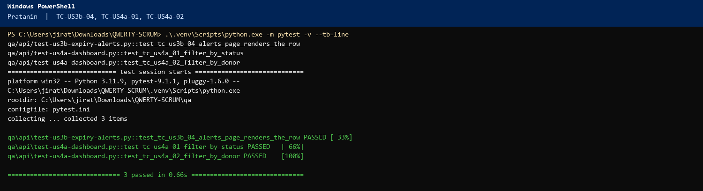
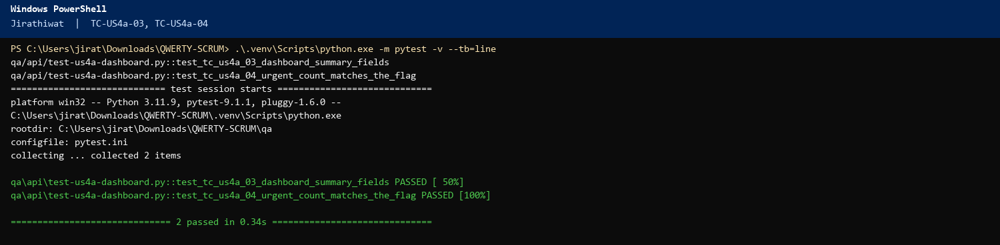
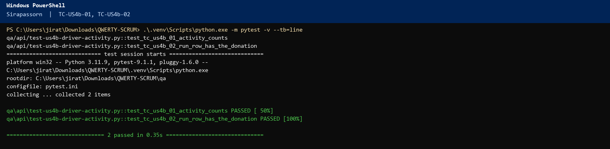
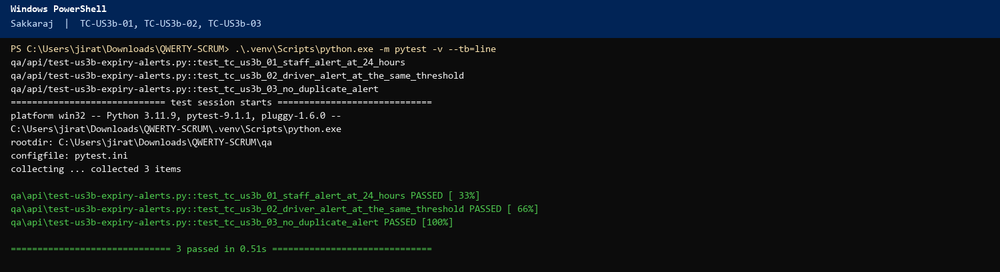

# Sprint 2 – Scrum Meeting 4 Script (QWERTY)

Monday 9 November 2026. Three-question format.

## Meeting at a glance

Friday 6 November was Sprint Day 3. That standup reported only Days 1–2. This meeting reports the work since then: **Days 3–4 (18 hours)** and **Days 5–7 (24 hours)**. US9a and US9b move to **Done** only if their test cases are Green. “What will I do next?” is the next test cases, not only a task name.

| Item | Detail |
|---|---|
| Date | Monday 9 November 2026 |
| Length | About 10 minutes |
| Facilitator | Napat Tayommai (Scrum Master) |
| Reports | Days 5–7, **24 hours** (Pratanin 4, Jirathiwat 12, Sirapassorn 4, Sakkaraj 4) |
| Next | Wednesday 11 November, Meeting 5 (**Days 8–9**, 17 hours) |
| Three questions | 1. Accomplished since Friday. 2. What will I do next? (test case number, name, expected output). 3. Blockers. |

## Before the meeting

1. Open `docs/sprint-2-tdd-report.docx`. Log Days 3–7 before anyone speaks.
2. Have `qa/api/test-zz-donor-edit-split.py` output ready.
3. Do not say US4a, US4b, US5b, US7, or US8 are Done.
4. Demo: http://localhost:3000

---

## The script

### 1. Opening (Napat, about 1 minute)

Good morning. This is Scrum meeting **four**, **Monday 9 November**. Friday was Day 3. We did not claim Days 3–4 in that room. Those hours are now logged, and so are Days 5–7. Next is still a list of test cases. The TDD report is on screen.

Pratanin, please start.

### 2. Pratanin, Dev 1 (about 1.5 minutes)

**Accomplished:** Day 5 and Day 6 were **0 hours** for me. Day 7 was **4 hours**, split across two cards, both **In Progress**. **US3b alerts page** is **2 of 4**: `/notifications` lists `thresholdHours`, `message`, and `createdAt`. **US4a filters** are **2 of 6**: `/dashboard` has donor text, food-bank id, and status selects, not wired to every count yet.

**Next:** I write these cases before I finish the screens. Days 8–9.

- **TC-US3b-04** Open `/notifications`. Expected: each row shows `thresholdHours` and the message.
- **TC-US4a-01** Filter status `delivered`. Expected: queued rows disappear.
- **TC-US4a-02** Filter the donor name. Expected: only that donor’s rows remain.

The terminal picture shows PASSED for TC-US3b-04, TC-US4a-01, and TC-US4a-02. US4a is not Done. Its QA case is still later.

**Blockers:** None.

### 3. Napat to Jirathiwat

Thanks, Pratanin. Jirathiwat.

### 4. Jirathiwat, Dev 3 (about 1.5 minutes)

**Accomplished:** Days 5 and 6 were **6 hours** each, **12 hours** total. **US9b Subtract quantityKg** is **6 of 6** and **In Review**. Edit releases the old kilograms, then `placeMatches` subtracts each `quantityKg`. A 190 kg split leaves SOS and Thonburi reduced by 164 and 26, not by 190 twice. **US3b notification job** is **6 of 6** and **In Review**. `refreshDonationFlags` pushes a staff notification at 24, 12, and 2 hours, once per threshold.

**Next:** Days 8–9 are the dashboard API, **5 hours**. Tests first.

- **TC-US4a-03** `GET /api/dashboard`. Expected: `summary` has `open`, `matched`, `pickedUp`, `delivered`, `urgent`, `foodBanks`, `notifications`.
- **TC-US4a-04** A donation inside 24 hours. Expected: `urgent` count includes it and a delivered donation does not.

The terminal picture shows PASSED for TC-US4a-03 and TC-US4a-04.

**Blockers:** None.

### 5. Napat to Sirapassorn

Thanks, Jirathiwat. Sirapassorn.

### 6. Sirapassorn, Dev 2 (about 1.5 minutes)

**Accomplished:** **US3b driver-audience notifications** are **4 of 4 hours** (Day 5 was 2, Day 6 was 2) and **In Review**. The same threshold writes a second row with `audience: "driver"`. Day 7 was **0 hours**.

**Next:** Day 9 starts **US4b**, **3 of 6 hours**. The last 3 hours are Day 10. Tests first.

- **TC-US4b-01** `GET /api/drivers/activity`. Expected: each driver has `accepted`, `pickedUp`, `delivered`.
- **TC-US4b-02** After a pickup, that driver’s `runs` include the `donationId`.

The terminal picture shows PASSED for TC-US4b-01 and TC-US4b-02. The last 3 hours of this card are still Day 10.

**Blockers:** None.

### 7. Napat to Sakkaraj

Thank you. Sakkaraj.

### 8. Sakkaraj, QA 1 (about 1.5 minutes)

**Accomplished:** **US9b QA** is **4 of 4 hours** (Day 6 was 2, Day 7 was 2). `test_one_log_can_hold_many_foods_and_split_across_banks` passed: quantity 190, two lines, at least two matches, sum of `quantityKg` is 190. US1b still matches 10 kg in range with capacity, and 4000 kg stays queued with `match` null. The full `qa/api` run is green. UI pass: donor edit, split checkbox, and the two bank lines on the result panel.

**Next:** Day 8 is **US3b QA**, **3 hours**. These are the cases.

- **TC-US3b-01** Expiry inside 24 hours. Expected: one staff notification at threshold 24.
- **TC-US3b-02** The same donation. Expected: one driver notification at the same threshold.
- **TC-US3b-03** Refresh again. Expected: no second pair.

The terminal picture shows PASSED for TC-US3b-01, TC-US3b-02, and TC-US3b-03 in `qa/api/test-us3b-expiry-alerts.py`.

**Blockers:** None.

### 9. Napat's own update (about 1 minute)

**Accomplished:** Days 5–7 are **24 hours**. Running total **56 of 113**.

**Next:** I update the TDD report before anyone says Done.

- **TC-RPT-03** US9a rows TC-US9a-01 and TC-US9a-02 are Green. Expected: only then does US9a move to Done.
- **TC-RPT-04** US9b rows TC-US9b-04 and TC-US9b-06 are Green. Expected: only then does US9b move to Done.

US3b stays In Review. Meeting 5 must not say the dashboard or the activity log are finished.

**Blockers:** None.

### 10. Blocker and risk review (Napat, about 1 minute)

No open blocker. Watch capacity: an edit must `releaseMatches` before `placeMatches`, or the second save will see 0 kg at SOS and fail to rematch. Anyone disagree?

### 11. Definition of Done check (Napat, about 1.5 minutes)

US9a: acceptance criteria met, PATCH reviewed, `test_donor_can_edit_a_donation_before_pickup` green, 409 after pickup, no critical bugs, hours logged. US9b: one log, many foods, many banks, sum of `quantityKg` equals `quantity`, Sprint 1 match time still under 120 seconds, hours logged. If Sakkaraj confirms both, those two stories move to **Done**. US3b does not. Its QA is still To-Do until Day 8.

### 12. Closing (Napat, about 30 seconds)

Next standup is **Wednesday 11 November, 09:00**, Meeting 5. Thank you.

---

## Example card positions after DoD

| Card | Owner | Column |
|---|---|---|
| US9a all tasks | Pratanin, Jirathiwat, Sakkaraj | Done |
| US9b all tasks | Pratanin, Sirapassorn, Jirathiwat, Sakkaraj | Done |
| US3b job (6/6) and driver alerts (4/4) | Jirathiwat, Sirapassorn | In Review |
| US3b alerts page (2/4) | Pratanin | In Progress |
| US3b QA (0/3) | Sakkaraj | To-Do |
| US4a filters (2/6) | Pratanin | In Progress |
| US4b, US5b, US7, US8 | — | To-Do |

## Terminal evidence

Run on Friday 6 November 2026 against http://localhost:3000. The picture is the terminal. The code under it is the test that produced that result.

### Pratanin



```python
def test_tc_us3b_04_alerts_page_renders_the_row():
    donation_id = _urgent_donation()["donation"]["donationId"]
    notes = donor().get(f"{BASE_URL}/api/notifications", timeout=10).json()["notifications"]
    row = next(item for item in notes if item["donationId"] == donation_id and item["audience"] == "staff")
    assert row["thresholdHours"] == 24
    assert donation_id in row["message"]

def test_tc_us4a_01_filter_by_status():
    donation_id = create_donation(donor(), quantity=4)["donation"]["donationId"]
    driver_session = driver()
    assert driver_session.post(f"{BASE_URL}/api/pickup", json={"donationId": donation_id}, timeout=10).status_code == 200
    assert driver_session.post(
        f"{BASE_URL}/api/delivery",
        json={"donationId": donation_id, "proofKind": "signature", "proofDataUrl": PROOF},
        timeout=10,
    ).status_code == 200
    donations = _board()["donations"]
    delivered = [item for item in donations if item["status"] == "delivered"]
    assert any(item["donationId"] == donation_id for item in delivered)
    assert all(item["status"] == "delivered" for item in delivered)

def test_tc_us4a_02_filter_by_donor():
    create_donation(donor(), quantity=3)
    donations = _board()["donations"]
    matched = [item for item in donations if "Bangkok Fresh Market" in item["donorName"]]
    assert matched
    assert all("Bangkok Fresh Market" in item["donorName"] for item in matched)
```

### Jirathiwat



```python
def test_tc_us4a_03_dashboard_summary_fields():
    summary = _board()["summary"]
    for key in ("open", "matched", "pickedUp", "delivered", "urgent", "foodBanks", "notifications"):
        assert key in summary

def test_tc_us4a_04_urgent_count_matches_the_flag():
    create_donation(donor(), expiryDateTime=future_expiry(60))
    summary = _board()["summary"]
    assert summary["urgent"] >= 1
```

### Sirapassorn



```python
def test_tc_us4b_01_activity_counts():
    row = next(item for item in _activity() if item["driverId"] == "usr-driver-1")
    for key in ("accepted", "pickedUp", "delivered"):
        assert key in row

def test_tc_us4b_02_run_row_has_the_donation():
    donation_id = create_donation(donor(), quantity=4)["donation"]["donationId"]
    assert driver().post(f"{BASE_URL}/api/pickup", json={"donationId": donation_id}, timeout=10).status_code == 200
    row = next(item for item in _activity() if item["driverId"] == "usr-driver-1")
    assert any(run["donationId"] == donation_id for run in row["runs"])
```

### Sakkaraj



```python
def test_tc_us3b_01_staff_alert_at_24_hours():
    donation_id = _urgent_donation()["donation"]["donationId"]
    notes = donor().get(f"{BASE_URL}/api/notifications", timeout=10).json()["notifications"]
    staff = [item for item in notes if item["donationId"] == donation_id and item["thresholdHours"] == 24 and item["audience"] == "staff"]
    assert len(staff) == 1

def test_tc_us3b_02_driver_alert_at_the_same_threshold():
    donation_id = _urgent_donation()["donation"]["donationId"]
    notes = donor().get(f"{BASE_URL}/api/notifications", timeout=10).json()["notifications"]
    drivers = [item for item in notes if item["donationId"] == donation_id and item["thresholdHours"] == 24 and item["audience"] == "driver"]
    assert len(drivers) == 1

def test_tc_us3b_03_no_duplicate_alert():
    donation_id = _urgent_donation()["donation"]["donationId"]
    session = donor()
    session.get(f"{BASE_URL}/api/donations/{donation_id}", timeout=10)
    notes = session.get(f"{BASE_URL}/api/notifications", timeout=10).json()["notifications"]
    rows = [item for item in notes if item["donationId"] == donation_id and item["thresholdHours"] == 24]
    assert len(rows) == 2
```
