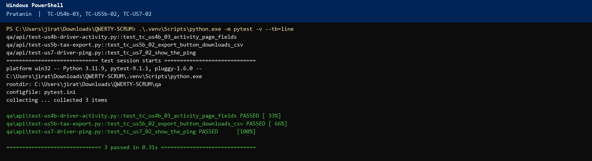
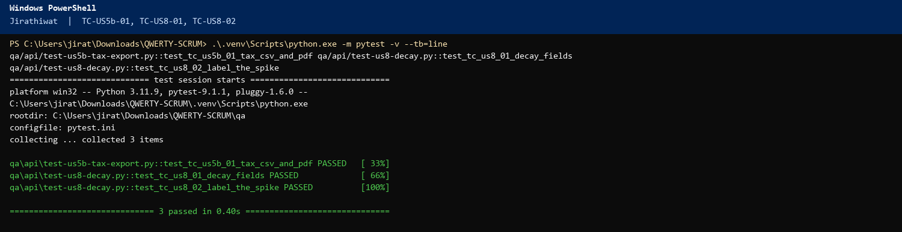
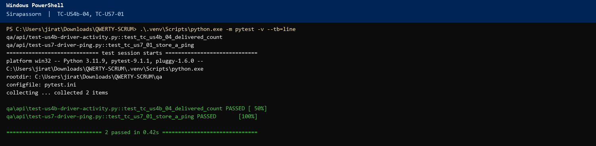
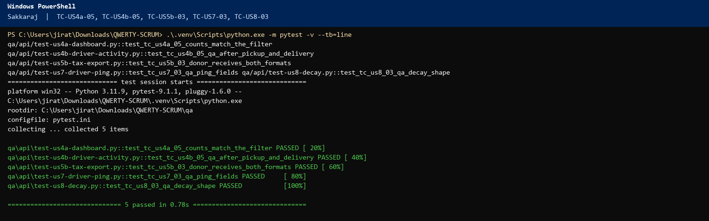

# Sprint 2 – Scrum Meeting 5 Script (QWERTY)

Wednesday 11 November 2026. Three-question format.

## Meeting at a glance

Meeting 5 reports **Days 8–9** (Monday 9 and Tuesday 10 November), **17 hours**. US3b hours are complete and the story is **In Review** until this meeting's Definition of Done. US4a filters are **4 of 6** at the end of Day 8 and **6 of 6** at the end of Day 9, so this window closes the filter hours. The dashboard API is **5 of 5**. Dashboard QA has not started. Activity API is **3 of 6**.

| Item | Detail |
|---|---|
| Date | Wednesday 11 November 2026 |
| Length | About 10 minutes |
| Facilitator | Napat Tayommai (Scrum Master) |
| Reports | Days 8–9, **17 hours** (Pratanin 6, Jirathiwat 5, Sirapassorn 3, Sakkaraj 3) |
| Next | Friday 13 November, Meeting 6, the close (**Days 10–14**, 40 hours, Day 15 = 0) |
| Three questions | 1. Accomplished since Monday. 2. What will I do next? (test case number, name, expected output). 3. Blockers. |

## Before the meeting

1. Open `docs/sprint-2-tdd-report.docx`. Log Days 8–9 before anyone speaks.
2. US9a and US9b stay Done. Do not re-estimate them.
3. Demo: http://localhost:3000/dashboard and `/notifications`

---

## The script

### 1. Opening (Napat, about 1 minute)

Good morning. This is Scrum meeting **five**, **Wednesday 11 November**. Monday we closed the two donor stories if DoD passed, and we left US3b in review. Days 8 and 9 were **17 hours**: alerts UI and QA, the dashboard summary, and the start of driver activity. Tax export, GPS, and decay are still To-Do.

Pratanin, please start.

### 2. Pratanin, Dev 1 (about 1.5 minutes)

**Accomplished:** Day 8 was **4 hours** and Day 9 was **2 hours**, **6 hours** in this window. **US3b alerts page** is now **4 of 4** and **In Review**. `/notifications` shows staff and driver rows. **US4a filters** moved from **2 of 6** to **6 of 6** (2 hours Monday, 2 hours Tuesday) and are **In Review**. The board filters by donor name, `foodBankId`, and `status`.

**Next:** Tests before the screens. Friday is the close.

- **TC-US4b-03** Open `/drivers`. Expected: the driver name and the three counts are visible.
- **TC-US5b-02** On `/receipts`, choose a month and Export CSV. Expected: a file download, not the Sprint 1 receipt PDF.
- **TC-US7-02** After a ping, `/drivers` shows latitude, longitude, and `recordedAt` in Asia/Bangkok.

The terminal picture shows PASSED for TC-US4b-03, TC-US5b-02, and TC-US7-02.

**Blockers:** None.

### 3. Napat to Jirathiwat

Thanks, Pratanin. Jirathiwat.

### 4. Jirathiwat, Dev 3 (about 1.5 minutes)

**Accomplished:** **US4a GET /api/dashboard** is **5 of 5 hours** (Day 8 was 2, Day 9 was 3) and **In Review**. The JSON `summary` has `open`, `matched`, `pickedUp`, `delivered`, `urgent`, `foodBanks`, and `notifications`. Donors on the list are already limited to their own rows by the existing donations query.

**Next:** Day 10 is **0**. Then tax and decay. Tests first.

- **TC-US5b-01** `GET /api/reports/tax?format=csv` and `format=pdf` for a month. Expected: **200**. This is not the US5a receipt.
- **TC-US8-01** `GET /api/decay?donationId=`. Expected: `hoursRemaining` and `riskScore`.
- **TC-US8-02** The same response. Expected: `method` is `heuristic-spike`.

The terminal picture shows PASSED for TC-US5b-01, TC-US8-01, and TC-US8-02.

**Blockers:** None.

### 5. Napat to Sirapassorn

Thanks, Jirathiwat. Sirapassorn.

### 6. Sirapassorn, Dev 2 (about 1.5 minutes)

**Accomplished:** Day 8 was **0**. Day 9 was **3 hours** on **US4b GET /api/drivers/activity**, so the card is **3 of 6** and **In Progress**. The handler returns one object per driver user: counts, `location` from the latest ping, and `runs` sorted by delivered or picked-up time.

**Next:** Day 10 finishes the activity API. Days 12–13 are GPS. Tests first.

- **TC-US4b-04** After delivery, `delivered` for `usr-driver-1` is at least 1.
- **TC-US7-01** `POST /api/drivers/location` with `lat` and `lng`. Expected: one ping for that driver, with `recordedAt`.

The terminal picture shows PASSED for TC-US4b-04 and TC-US7-01.

**Blockers:** None.

### 7. Napat to Sakkaraj

Thank you. Sakkaraj.

### 8. Sakkaraj, QA 1 (about 1.5 minutes)

**Accomplished:** **US3b QA** is **3 of 3 hours** on Day 8 and **In Review**. A donation inside 24 hours creates one staff notification and one driver notification at threshold 24. Refresh does not insert a second pair. Day 9 was **0 hours**. I have not tested the dashboard filters yet.

**Next:** These are the cases I run before Friday’s close. Day 12 is **0**.

- **TC-US4a-05** Dashboard counts match the filtered rows. Expected: delivered count equals the delivered rows.
- **TC-US4b-05** After pickup and delivery, the activity row shows that `donationId`.
- **TC-US5b-03** CSV and PDF for the month both return **200** for the donor.
- **TC-US7-03** The ping on the activity log has `lat`, `lng`, and `recordedAt`.
- **TC-US8-03** Decay returns `hoursRemaining`, `riskScore`, and `method`.

The terminal picture shows PASSED for TC-US4a-05, TC-US4b-05, TC-US5b-03, TC-US7-03, and TC-US8-03.

**Blockers:** None.

### 9. Napat's own update (about 1 minute)

**Accomplished:** Days 8–9 are **17 hours**. Running total **73 of 113**.

**Next:** I only move US3b to Done if TC-US3b-01, TC-US3b-02, and TC-US3b-03 are Green in the TDD report. US4a stays open: TC-US4a-05 is still Red. Friday 13 is the close. There is no standup after that.

**Blockers:** None.

### 10. Blocker and risk review (Napat, about 1 minute)

US5b must stay labeled Sprint 2 on the receipts page. It is not a Sprint 1 receipt. The US1a queue contract is unchanged. Anyone else?

### 11. Definition of Done check (Napat, about 1.5 minutes)

US3b, before Done: 24, 12, and 2 hour rows exist once, both audiences, the page renders them, no critical bugs, hours logged. If Sakkaraj confirms, move US3b to **Done**. Leave US4a In Review. Leave US4b In Progress at 3 of 6.

### 12. Closing (Napat, about 30 seconds)

Next standup is **Friday 13 November, 09:00**, Meeting 6, the Sprint 2 close. Thank you.

---

## Example card positions

| Card | Owner | Column |
|---|---|---|
| US9a, US9b | team | Done |
| US3b all tasks | team | Done, if this DoD passed |
| US4a filters (6/6) and API (5/5) | Pratanin, Jirathiwat | In Review |
| US4a QA (0/3) | Sakkaraj | To-Do |
| US4b activity API (3/6) | Sirapassorn | In Progress |
| US5b, US7, US8 | — | To-Do |

## Terminal evidence

Run on Friday 6 November 2026 against http://localhost:3000. The picture is the terminal. The code under it is the test that produced that result.

### Pratanin



```python
def test_tc_us4b_03_activity_page_fields():
    row = next(item for item in _activity() if item["driverId"] == "usr-driver-1")
    assert row["name"]
    assert isinstance(row["accepted"], int)
    assert isinstance(row["pickedUp"], int)
    assert isinstance(row["delivered"], int)

def test_tc_us5b_02_export_button_downloads_csv():
    month = datetime.now(timezone.utc).strftime("%Y-%m")
    response = donor().get(f"{BASE_URL}/api/reports/tax?format=csv&month={month}", timeout=10)
    assert response.status_code == 200
    assert "attachment" in response.headers.get("content-disposition", "")
    assert response.text.splitlines()[0].startswith("receiptId,donationId,foodType")

def test_tc_us7_02_show_the_ping():
    assert driver().post(f"{BASE_URL}/api/drivers/location", json={"lat": 13.76, "lng": 100.52}, timeout=10).status_code == 200
    row = next(item for item in foodbank().get(f"{BASE_URL}/api/drivers/activity", timeout=10).json()["drivers"] if item["driverId"] == "usr-driver-1")
    assert row["location"]["lat"] == 13.76
    assert row["location"]["lng"] == 100.52
    assert row["location"]["recordedAt"]
```

### Jirathiwat



```python
def test_tc_us5b_01_tax_csv_and_pdf():
    session = donor()
    month = datetime.now(timezone.utc).strftime("%Y-%m")
    csv_file = session.get(f"{BASE_URL}/api/reports/tax?format=csv&month={month}", timeout=10)
    pdf_file = session.get(f"{BASE_URL}/api/reports/tax?format=pdf&month={month}", timeout=10)
    assert csv_file.status_code == 200, csv_file.text
    assert pdf_file.status_code == 200
    assert "text/csv" in csv_file.headers["content-type"]
    assert "application/pdf" in pdf_file.headers["content-type"]

def test_tc_us8_01_decay_fields():
    donation_id = create_donation(donor(), quantity=2)["donation"]["donationId"]
    estimate = donor().get(f"{BASE_URL}/api/decay", params={"donationId": donation_id}, timeout=10).json()["estimate"]
    assert "hoursRemaining" in estimate
    assert "riskScore" in estimate

def test_tc_us8_02_label_the_spike():
    donation_id = create_donation(donor(), quantity=2)["donation"]["donationId"]
    estimate = donor().get(f"{BASE_URL}/api/decay", params={"donationId": donation_id}, timeout=10).json()["estimate"]
    assert estimate["method"] == "heuristic-spike"
```

### Sirapassorn



```python
def test_tc_us4b_04_delivered_count():
    donation_id = create_donation(donor(), quantity=4)["donation"]["donationId"]
    driver_session = driver()
    assert driver_session.post(f"{BASE_URL}/api/pickup", json={"donationId": donation_id}, timeout=10).status_code == 200
    assert driver_session.post(
        f"{BASE_URL}/api/delivery",
        json={"donationId": donation_id, "proofKind": "signature", "proofDataUrl": PROOF},
        timeout=10,
    ).status_code == 200
    row = next(item for item in _activity() if item["driverId"] == "usr-driver-1")
    assert row["delivered"] >= 1

def test_tc_us7_01_store_a_ping():
    response = driver().post(f"{BASE_URL}/api/drivers/location", json={"lat": 13.75, "lng": 100.51}, timeout=10)
    assert response.status_code == 200, response.text
    ping = response.json()["location"]
    assert ping["driverId"] == "usr-driver-1"
    assert ping["lat"] == 13.75
    assert ping["lng"] == 100.51
    assert ping["recordedAt"]
```

### Sakkaraj



```python
def test_tc_us4a_05_counts_match_the_filter():
    board = _board()
    delivered_rows = [item for item in board["donations"] if item["status"] == "delivered"]
    assert board["summary"]["delivered"] == len(delivered_rows)

def test_tc_us4b_05_qa_after_pickup_and_delivery():
    donation_id = create_donation(donor(), quantity=3)["donation"]["donationId"]
    driver_session = driver()
    assert driver_session.post(f"{BASE_URL}/api/pickup", json={"donationId": donation_id}, timeout=10).status_code == 200
    assert driver_session.post(
        f"{BASE_URL}/api/delivery",
        json={"donationId": donation_id, "proofKind": "signature", "proofDataUrl": PROOF},
        timeout=10,
    ).status_code == 200
    row = next(item for item in _activity() if item["driverId"] == "usr-driver-1")
    assert any(run["donationId"] == donation_id and run["status"] == "delivered" for run in row["runs"])

def test_tc_us5b_03_donor_receives_both_formats():
    session = donor()
    month = datetime.now(timezone.utc).strftime("%Y-%m")
    assert session.get(f"{BASE_URL}/api/reports/tax?format=csv&month={month}", timeout=10).status_code == 200
    assert session.get(f"{BASE_URL}/api/reports/tax?format=pdf&month={month}", timeout=10).status_code == 200

def test_tc_us7_03_qa_ping_fields():
    assert driver().post(f"{BASE_URL}/api/drivers/location", json={"lat": 13.77, "lng": 100.53}, timeout=10).status_code == 200
    locations = foodbank().get(f"{BASE_URL}/api/drivers/location", timeout=10).json()["locations"]
    ping = next(item for item in locations if item["driverId"] == "usr-driver-1")
    assert {"lat", "lng", "recordedAt"} <= set(ping)

def test_tc_us8_03_qa_decay_shape():
    donation_id = create_donation(donor(), quantity=2)["donation"]["donationId"]
    estimate = donor().get(f"{BASE_URL}/api/decay", params={"donationId": donation_id}, timeout=10).json()["estimate"]
    assert estimate["donationId"] == donation_id
    assert {"hoursRemaining", "riskScore", "method"} <= set(estimate)
```
