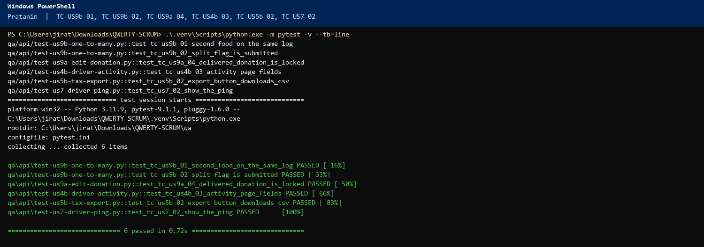
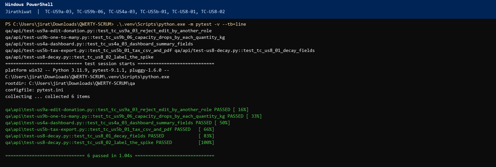
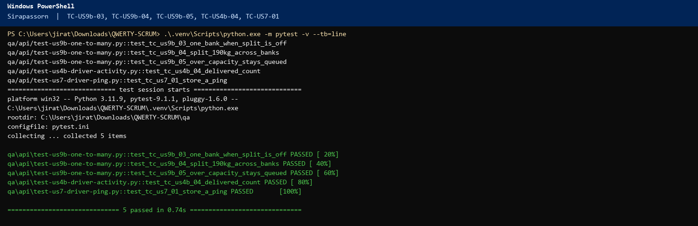
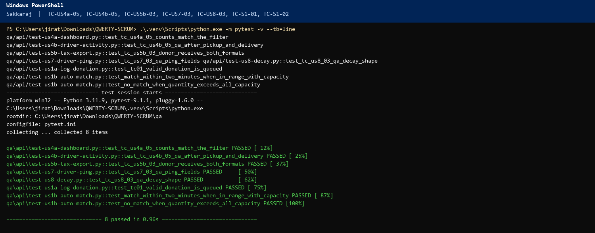

# Sprint 2 – Scrum Meeting 6 Script (QWERTY)

Friday 13 November 2026. Sprint close. Three-question format.

## Meeting at a glance

Meeting 6 is the **last Daily Scrum of Sprint 2**. The sprint ends today, **Friday 13 November**. It reports **Days 10–14** (work since Wednesday 11 November), **40 hours**. **Day 15's build cell is 0.** There is no standup on Monday 16. The sprint is 8 stories and **113** planned hours. Move a card to Done only if the Definition of Done in this meeting is true. Each case below includes the command. Start the site (`cd web`, then `npm run dev`) and run the command from the repo root.

| Item | Detail |
|---|---|
| Date | Friday 13 November 2026 |
| Length | About 10 minutes |
| Facilitator | Napat Tayommai (Scrum Master) |
| Reports | Days 10–14, **40 hours** (Pratanin 10, Jirathiwat 9, Sirapassorn 9, Sakkaraj 12). Day 15 = 0 |
| Next | Sprint Review after this standup. No further Daily Scrum in Sprint 2. |
| Three questions | 1. Accomplished since Wednesday. 2. What will I do next? (the test cases I will run in the Review). 3. Blockers. |

## Before the meeting

1. Open `docs/sprint-2-tdd-report.docx`. Log Days 10–14. Leave the Day 15 column at 0.
2. Share the board and `docs/sprint-2-backlog.xlsx`.
3. Have pytest output for `qa/api`, including `test-zz-donor-edit-split.py`.
4. Demo: http://localhost:3000

---

## The script

### 1. Opening (Napat, about 1 minute)

Good morning. This is Scrum meeting **six**, **Friday 13 November**, the Sprint 2 close. The sprint ends today. There is no Monday standup. Wednesday we had US3b ready for Done, the dashboard and activity log still open, and tax, GPS, and decay still To-Do. Days 10 through 14 were **40 hours**. Day 15 is **0**. Planned total is **113**. Window check: 14 + 18 + 24 + 17 + 40 = 113.

We do not add scope. US9a is edit. US9b is one log to many food banks. Then US3b, US4a, US4b, US5b, US7, and US8.

Pratanin, please start.

### 2. Pratanin, Dev 1 (about 1.5 minutes)

**Accomplished:** **10 hours** since Wednesday. **US4b the driver activity page** is **4 of 4** (Day 10 was 2, Day 11 was 2) and **In Review**. `/drivers` shows accepted, picked up, and delivered counts. **US5b Export CSV and Export PDF** is **3 of 3** on Day 12 and **In Review**. The receipts page calls `GET /api/reports/tax` for the selected month. **US7 show the latest ping** is **3 of 3** on Day 13 and **In Review**. The page prints latitude, longitude, and `recordedAt` in Asia/Bangkok. Day 14 was **0**.

**Next:** In the Review I will execute these cases, then stop.

- **TC-US9b-01**. Expected: two foods on one log, `quantity` equals the sum of the lines.

  `.\.venv\Scripts\python.exe -m pytest qa/api/test-us9b-one-to-many.py::test_tc_us9b_01_second_food_on_the_same_log -q`

- **TC-US9b-02**. Expected: `splitAcrossBanks` true.

  `.\.venv\Scripts\python.exe -m pytest qa/api/test-us9b-one-to-many.py::test_tc_us9b_02_split_flag_is_submitted -q`

- **TC-US9a-04**. Expected: a delivered log shows Locked.

  `.\.venv\Scripts\python.exe -m pytest qa/api/test-us9a-edit-donation.py::test_tc_us9a_04_delivered_donation_is_locked -q`

- **TC-US4b-03**. Expected: activity counts are visible.

  `.\.venv\Scripts\python.exe -m pytest qa/api/test-us4b-driver-activity.py::test_tc_us4b_03_activity_page_fields -q`

- **TC-US5b-02**. Expected: a tax CSV download.

  `.\.venv\Scripts\python.exe -m pytest qa/api/test-us5b-tax-export.py::test_tc_us5b_02_export_button_downloads_csv -q`

- **TC-US7-02**. Expected: a ping on `/drivers`.

  `.\.venv\Scripts\python.exe -m pytest qa/api/test-us7-driver-ping.py::test_tc_us7_02_show_the_ping -q`

**Blockers:** None.

### 3. Napat to Jirathiwat

Thanks, Pratanin. Jirathiwat.

### 4. Jirathiwat, Dev 3 (about 1.5 minutes)

**Accomplished:** **9 hours**. Day 10 was **0**. Day 11 was **2 hours** and Day 12 was **3 hours** on **US5b tax CSV and PDF**, so that card is **5 of 5** and **In Review**. `GET /api/reports/tax` accepts `format=csv` or `format=pdf`. It is not the US5a per-donation receipt. Day 13 was **2 hours** and Day 14 was **2 hours** on **US8 GET /api/decay**, **4 of 4** and **In Review**. `hoursRemaining` comes from `expiryDateTime`. `riskScore` is the heuristic. `method` is `heuristic-spike`. The note says this is not a trained model.

**Next:** In the Review I will run these and show the result in the TDD report.

- **TC-US9a-03**. Expected: **403** for a food bank PATCH.

  `.\.venv\Scripts\python.exe -m pytest qa/api/test-us9a-edit-donation.py::test_tc_us9a_03_reject_edit_by_another_role -q`

- **TC-US9b-06**. Expected: SOS drops by 164 kg, not 190.

  `.\.venv\Scripts\python.exe -m pytest qa/api/test-us9b-one-to-many.py::test_tc_us9b_06_capacity_drops_by_each_quantity_kg -q`

- **TC-US4a-03**. Expected: dashboard summary fields.

  `.\.venv\Scripts\python.exe -m pytest qa/api/test-us4a-dashboard.py::test_tc_us4a_03_dashboard_summary_fields -q`

- **TC-US5b-01**. Expected: tax CSV and PDF return **200**.

  `.\.venv\Scripts\python.exe -m pytest qa/api/test-us5b-tax-export.py::test_tc_us5b_01_tax_csv_and_pdf -q`

- **TC-US8-01**. Expected: decay fields `hoursRemaining` and `riskScore`.

  `.\.venv\Scripts\python.exe -m pytest qa/api/test-us8-decay.py::test_tc_us8_01_decay_fields -q`

- **TC-US8-02**. Expected: `method` is `heuristic-spike`.

  `.\.venv\Scripts\python.exe -m pytest qa/api/test-us8-decay.py::test_tc_us8_02_label_the_spike -q`

**Blockers:** None.

### 5. Napat to Sirapassorn

Thanks, Jirathiwat. Sirapassorn.

### 6. Sirapassorn, Dev 2 (about 1.5 minutes)

**Accomplished:** **9 hours**. **US4b activity API** is now **6 of 6**. Day 10 was the last **3 hours**. Day 11 was **0**. **US7 POST /api/drivers/location** is **6 of 6** (Day 12 was 3, Day 13 was 3) and **In Review**. A driver posts `lat` and `lng`. We keep one ping per driver. `recordedAt` is ISO time. The activity endpoint returns that ping, so the page can show it inside a minute. Day 14 was **0**.

**Next:** In the Review I will run these.

- **TC-US9b-03**. Expected: one match at 10 kg.

  `.\.venv\Scripts\python.exe -m pytest qa/api/test-us9b-one-to-many.py::test_tc_us9b_03_one_bank_when_split_is_off -q`

- **TC-US9b-04**. Expected: two or more matches at 190 kg.

  `.\.venv\Scripts\python.exe -m pytest qa/api/test-us9b-one-to-many.py::test_tc_us9b_04_split_190kg_across_banks -q`

- **TC-US9b-05**. Expected: no match at 4000 kg.

  `.\.venv\Scripts\python.exe -m pytest qa/api/test-us9b-one-to-many.py::test_tc_us9b_05_over_capacity_stays_queued -q`

- **TC-US4b-04**. Expected: delivered count at least 1.

  `.\.venv\Scripts\python.exe -m pytest qa/api/test-us4b-driver-activity.py::test_tc_us4b_04_delivered_count -q`

- **TC-US7-01**. Expected: one ping stored.

  `.\.venv\Scripts\python.exe -m pytest qa/api/test-us7-driver-ping.py::test_tc_us7_01_store_a_ping -q`

**Blockers:** None.

### 7. Napat to Sakkaraj

Thank you. Sakkaraj.

### 8. Sakkaraj, QA 1 (about 1.5 minutes)

**Accomplished:** **12 hours**. Day 10 was **US4a QA, 3 of 3**: summary counts change when status is `delivered`, and the donor filter hides other organizations. Day 11 was **US4b QA, 3 of 3**: after pickup and delivery, `delivered` is at least 1 for `usr-driver-1`. Day 12 was **0**. Day 13 was **US5b QA, 2 of 2**: CSV and PDF for the month return 200. Day 14 was **4 hours**: **US7 QA, 2 of 2**, the ping shows `lat`, `lng`, and `recordedAt`, and **US8 QA, 2 of 2**, `GET /api/decay?donationId=` returns `hoursRemaining` and `riskScore`. I re-ran `qa/api`. The edit test, the one-to-many test, and the Sprint 1 files are still green.

**Next:** I will run the full `qa/api` set and mark the report.

- **TC-US4a-05**. Expected: Green. Dashboard counts match the filtered rows.

  `.\.venv\Scripts\python.exe -m pytest qa/api/test-us4a-dashboard.py::test_tc_us4a_05_counts_match_the_filter -q`

- **TC-US4b-05**. Expected: Green. The activity row shows the `donationId`.

  `.\.venv\Scripts\python.exe -m pytest qa/api/test-us4b-driver-activity.py::test_tc_us4b_05_qa_after_pickup_and_delivery -q`

- **TC-US5b-03**. Expected: Green. CSV and PDF both return **200**.

  `.\.venv\Scripts\python.exe -m pytest qa/api/test-us5b-tax-export.py::test_tc_us5b_03_donor_receives_both_formats -q`

- **TC-US7-03**. Expected: Green. The ping has `lat`, `lng`, and `recordedAt`.

  `.\.venv\Scripts\python.exe -m pytest qa/api/test-us7-driver-ping.py::test_tc_us7_03_qa_ping_fields -q`

- **TC-US8-03**. Expected: Green. Decay returns `hoursRemaining`, `riskScore`, and `method`.

  `.\.venv\Scripts\python.exe -m pytest qa/api/test-us8-decay.py::test_tc_us8_03_qa_decay_shape -q`

- **TC-S1-01**. Expected: queue under 60 seconds.

  `.\.venv\Scripts\python.exe -m pytest qa/api/test-us1a-log-donation.py::test_tc01_valid_donation_is_queued -q`

- **TC-S1-02**. Expected: match under 120 seconds, and quantity 4000 stays queued.

  `.\.venv\Scripts\python.exe -m pytest qa/api/test-us1b-auto-match.py::test_match_within_two_minutes_when_in_range_with_capacity -q`

  `.\.venv\Scripts\python.exe -m pytest qa/api/test-us1b-auto-match.py::test_no_match_when_quantity_exceeds_all_capacity -q`

I will not open a new card after this meeting.

**Blockers:** None.

### 9. Napat's own update (about 1 minute)

**Accomplished:** Days 10–14 are **40 hours**. Day 15 is 0. If every DoD line below is true, actual hours are **113 of 113** and remaining is **0**.

**Next:** I submit `docs/sprint-2-tdd-report.docx` with the final presentation.

- **TC-RPT-05**. Expected: every Sprint 2 case is Green, or the story stays In Review. No pytest command. This is a report check.
- **TC-RPT-06**. Expected: the Review follows the Green cases only. No case that is still Red is called Done. No pytest command. This is a report check.

**Blockers:** None.

### 10. Blocker and risk review (Napat, about 1 minute)

No open Sprint 2 blocker. Carry-over is empty only if the eight stories all pass the list below. A failed pytest means that card stays In Review and remaining is not 0. The sprint does not continue on Monday. Does anyone disagree with the board?

### 11. Definition of Done check (Napat, about 1.5 minutes)

Read this before any card moves to Done.

- US9a: donor PATCH before pickup, 409 after pickup.
- US9b: one log, many foods, many banks, sum of `quantityKg` equals `quantity`.
- US3b: 24, 12, and 2 hour alerts for staff and drivers.
- US4a: dashboard counts and filters.
- US4b: driver activity counts after pickup and delivery.
- US5b: month CSV and PDF. Not the Sprint 1 receipt.
- US7: `POST /api/drivers/location` visible on `/drivers` within one minute.
- US8: `GET /api/decay` returns the heuristic, labeled as a spike.
- Sprint 1 queue still under 60 seconds and match still under 120 seconds.
- `qa/api` passes. No critical bugs. Hours on the sheet. Code reviewed on `main`.

If that list is true, all eight stories are **Done**. If any line fails, that story stays In Review.

### 12. Closing (Napat, about 30 seconds)

Thank you. That is the last Daily Scrum of Sprint 2. The sprint ends today, Friday 13 November. Please stay for the Sprint Review. The donor can edit a log, and one log can go to more than one food bank.

---

## Example card positions if DoD passes

| Card | Owner | Column |
|---|---|---|
| US9a Edit a logged donation | Pratanin, Jirathiwat, Sakkaraj | Done |
| US9b One log to many food banks | Pratanin, Sirapassorn, Jirathiwat, Sakkaraj | Done |
| US3b 24/12/2 alerts | Jirathiwat, Pratanin, Sirapassorn, Sakkaraj | Done |
| US4a Operations dashboard | Pratanin, Jirathiwat, Sakkaraj | Done |
| US4b Driver activity | Sirapassorn, Pratanin, Sakkaraj | Done |
| US5b Monthly tax export | Jirathiwat, Pratanin, Sakkaraj | Done |
| US7 Driver GPS ping | Sirapassorn, Pratanin, Sakkaraj | Done |
| US8 Decay spike | Jirathiwat, Sakkaraj | Done |

## Hours this window

| Person | Day 10 | Day 11 | Day 12 | Day 13 | Day 14 | Window |
|---|---:|---:|---:|---:|---:|---:|
| Pratanin | 2 | 2 | 3 | 3 | 0 | 10 |
| Jirathiwat | 0 | 2 | 3 | 2 | 2 | 9 |
| Sirapassorn | 3 | 0 | 3 | 3 | 0 | 9 |
| Sakkaraj | 3 | 3 | 0 | 2 | 4 | 12 |
| **TOTAL** | **8** | **7** | **9** | **10** | **6** | **40** |

## Terminal evidence

Run on Friday 6 November 2026 against http://localhost:3000. Each picture is that person's cases from the Next section above. The title bar lists the same TC numbers.

### Pratanin

Command for each case in this picture:

`.\.venv\Scripts\python.exe -m pytest qa/api/test-us9b-one-to-many.py::test_tc_us9b_01_second_food_on_the_same_log -q`

`.\.venv\Scripts\python.exe -m pytest qa/api/test-us9b-one-to-many.py::test_tc_us9b_02_split_flag_is_submitted -q`

`.\.venv\Scripts\python.exe -m pytest qa/api/test-us9a-edit-donation.py::test_tc_us9a_04_delivered_donation_is_locked -q`

`.\.venv\Scripts\python.exe -m pytest qa/api/test-us4b-driver-activity.py::test_tc_us4b_03_activity_page_fields -q`

`.\.venv\Scripts\python.exe -m pytest qa/api/test-us5b-tax-export.py::test_tc_us5b_02_export_button_downloads_csv -q`

`.\.venv\Scripts\python.exe -m pytest qa/api/test-us7-driver-ping.py::test_tc_us7_02_show_the_ping -q`

The picture is one run of those same tests:

`.\.venv\Scripts\python.exe -m pytest -v --tb=line qa/api/test-us9b-one-to-many.py::test_tc_us9b_01_second_food_on_the_same_log qa/api/test-us9b-one-to-many.py::test_tc_us9b_02_split_flag_is_submitted qa/api/test-us9a-edit-donation.py::test_tc_us9a_04_delivered_donation_is_locked qa/api/test-us4b-driver-activity.py::test_tc_us4b_03_activity_page_fields qa/api/test-us5b-tax-export.py::test_tc_us5b_02_export_button_downloads_csv qa/api/test-us7-driver-ping.py::test_tc_us7_02_show_the_ping`

### Jirathiwat

Command for each case in this picture:

`.\.venv\Scripts\python.exe -m pytest qa/api/test-us9a-edit-donation.py::test_tc_us9a_03_reject_edit_by_another_role -q`

`.\.venv\Scripts\python.exe -m pytest qa/api/test-us9b-one-to-many.py::test_tc_us9b_06_capacity_drops_by_each_quantity_kg -q`

`.\.venv\Scripts\python.exe -m pytest qa/api/test-us4a-dashboard.py::test_tc_us4a_03_dashboard_summary_fields -q`

`.\.venv\Scripts\python.exe -m pytest qa/api/test-us5b-tax-export.py::test_tc_us5b_01_tax_csv_and_pdf -q`

`.\.venv\Scripts\python.exe -m pytest qa/api/test-us8-decay.py::test_tc_us8_01_decay_fields -q`

`.\.venv\Scripts\python.exe -m pytest qa/api/test-us8-decay.py::test_tc_us8_02_label_the_spike -q`

The picture is one run of those same tests:

`.\.venv\Scripts\python.exe -m pytest -v --tb=line qa/api/test-us9a-edit-donation.py::test_tc_us9a_03_reject_edit_by_another_role qa/api/test-us9b-one-to-many.py::test_tc_us9b_06_capacity_drops_by_each_quantity_kg qa/api/test-us4a-dashboard.py::test_tc_us4a_03_dashboard_summary_fields qa/api/test-us5b-tax-export.py::test_tc_us5b_01_tax_csv_and_pdf qa/api/test-us8-decay.py::test_tc_us8_01_decay_fields qa/api/test-us8-decay.py::test_tc_us8_02_label_the_spike`

### Sirapassorn

Command for each case in this picture:

`.\.venv\Scripts\python.exe -m pytest qa/api/test-us9b-one-to-many.py::test_tc_us9b_03_one_bank_when_split_is_off -q`

`.\.venv\Scripts\python.exe -m pytest qa/api/test-us9b-one-to-many.py::test_tc_us9b_04_split_190kg_across_banks -q`

`.\.venv\Scripts\python.exe -m pytest qa/api/test-us9b-one-to-many.py::test_tc_us9b_05_over_capacity_stays_queued -q`

`.\.venv\Scripts\python.exe -m pytest qa/api/test-us4b-driver-activity.py::test_tc_us4b_04_delivered_count -q`

`.\.venv\Scripts\python.exe -m pytest qa/api/test-us7-driver-ping.py::test_tc_us7_01_store_a_ping -q`

The picture is one run of those same tests:

`.\.venv\Scripts\python.exe -m pytest -v --tb=line qa/api/test-us9b-one-to-many.py::test_tc_us9b_03_one_bank_when_split_is_off qa/api/test-us9b-one-to-many.py::test_tc_us9b_04_split_190kg_across_banks qa/api/test-us9b-one-to-many.py::test_tc_us9b_05_over_capacity_stays_queued qa/api/test-us4b-driver-activity.py::test_tc_us4b_04_delivered_count qa/api/test-us7-driver-ping.py::test_tc_us7_01_store_a_ping`

### Sakkaraj

Command for each case in this picture:

`.\.venv\Scripts\python.exe -m pytest qa/api/test-us4a-dashboard.py::test_tc_us4a_05_counts_match_the_filter -q`

`.\.venv\Scripts\python.exe -m pytest qa/api/test-us4b-driver-activity.py::test_tc_us4b_05_qa_after_pickup_and_delivery -q`

`.\.venv\Scripts\python.exe -m pytest qa/api/test-us5b-tax-export.py::test_tc_us5b_03_donor_receives_both_formats -q`

`.\.venv\Scripts\python.exe -m pytest qa/api/test-us7-driver-ping.py::test_tc_us7_03_qa_ping_fields -q`

`.\.venv\Scripts\python.exe -m pytest qa/api/test-us8-decay.py::test_tc_us8_03_qa_decay_shape -q`

`.\.venv\Scripts\python.exe -m pytest qa/api/test-us1a-log-donation.py::test_tc01_valid_donation_is_queued -q`

`.\.venv\Scripts\python.exe -m pytest qa/api/test-us1b-auto-match.py::test_match_within_two_minutes_when_in_range_with_capacity -q`

`.\.venv\Scripts\python.exe -m pytest qa/api/test-us1b-auto-match.py::test_no_match_when_quantity_exceeds_all_capacity -q`

The picture is one run of those same tests:

`.\.venv\Scripts\python.exe -m pytest -v --tb=line qa/api/test-us4a-dashboard.py::test_tc_us4a_05_counts_match_the_filter qa/api/test-us4b-driver-activity.py::test_tc_us4b_05_qa_after_pickup_and_delivery qa/api/test-us5b-tax-export.py::test_tc_us5b_03_donor_receives_both_formats qa/api/test-us7-driver-ping.py::test_tc_us7_03_qa_ping_fields qa/api/test-us8-decay.py::test_tc_us8_03_qa_decay_shape qa/api/test-us1a-log-donation.py::test_tc01_valid_donation_is_queued qa/api/test-us1b-auto-match.py::test_match_within_two_minutes_when_in_range_with_capacity qa/api/test-us1b-auto-match.py::test_no_match_when_quantity_exceeds_all_capacity`

Full suite on the same day: `pytest qa/api -q` finished with **60 passed**.
