# TDD Test Report

Team QWERTY. Rescue ERP, Sprint 2. Submit this file with the final presentation on **Friday 13 November 2026**.

Run on **Friday 6 November 2026**, Sprint Day 3, against `http://localhost:3000`. Every automated case below is **Green**. The picture is the actual terminal output. The title bar of each picture lists the same test-case numbers as the row.

Process checks for Napat (TC-RPT) are not pytest. They have no terminal picture.

## Register

| Feature | Expected output | Test Case Number | Test Case Name | Dev | Test Date | Cycle |
|---|---|---|---|---|---|---|
| US9a Edit a log | 200. foodType Dairy. quantity 6. lines[0] is Dairy. | TC-US9a-01 | Edit before pickup | Sakkaraj | 6 Nov 2026 | Green |
| US9a Edit a log | 409 after the driver has picked the food up. | TC-US9a-02 | Reject edit after pickup | Sakkaraj | 6 Nov 2026 | Green |
| US9a Edit a log | 403 when a food bank calls PATCH. | TC-US9a-03 | Reject edit by another role | Jirathiwat | 6 Nov 2026 | Green |
| US9a Edit a log | The donations list says Locked. No Edit link. | TC-US9a-04 | Hide edit after delivery | Pratanin | 6 Nov 2026 | Green |
| US9b One log, many banks | One donationId. lines length 2. quantity is the sum. | TC-US9b-01 | Second food on the same log | Pratanin | 6 Nov 2026 | Green |
| US9b One log, many banks | POST body has splitAcrossBanks true. | TC-US9b-02 | Split flag is submitted | Pratanin | 6 Nov 2026 | Green |
| US9b One log, many banks | Quantity 10, split false: one match, status matched. | TC-US9b-03 | One bank when split is off | Sirapassorn | 6 Nov 2026 | Green |
| US9b One log, many banks | 100 kg + 90 kg, split true: at least two matches, sum of quantityKg is 190. | TC-US9b-04 | Split 190 kg across banks | Sirapassorn | 6 Nov 2026 | Green |
| US9b One log, many banks | Quantity 4000: match is null, status queued. | TC-US9b-05 | Over capacity stays queued | Sirapassorn | 6 Nov 2026 | Green |
| US9b One log, many banks | SOS remainingCapacityKg falls by 164, not by 190. | TC-US9b-06 | Capacity drops by each quantityKg | Jirathiwat | 6 Nov 2026 | Green |
| US9b One log, many banks | Edit restores the old kilograms, then subtracts the new quantityKg. | TC-US9b-07 | Edit gives capacity back | Jirathiwat | 6 Nov 2026 | Green |
| US3b 24/12/2 alerts | One staff notification at threshold 24. | TC-US3b-01 | Staff alert at 24 hours | Sakkaraj | 6 Nov 2026 | Green |
| US3b 24/12/2 alerts | One driver notification at the same threshold. | TC-US3b-02 | Driver alert at the same threshold | Sakkaraj | 6 Nov 2026 | Green |
| US3b 24/12/2 alerts | A second refresh does not insert another pair. | TC-US3b-03 | No duplicate alert | Sakkaraj | 6 Nov 2026 | Green |
| US3b 24/12/2 alerts | /notifications shows thresholdHours and the message. | TC-US3b-04 | Alerts page renders the row | Pratanin | 6 Nov 2026 | Green |
| US4a Dashboard | summary has open, matched, pickedUp, delivered, urgent, foodBanks, notifications. | TC-US4a-03 | Dashboard summary fields | Jirathiwat | 6 Nov 2026 | Green |
| US4a Dashboard | urgent count includes a donation inside 24 hours and excludes a delivered one. | TC-US4a-04 | Urgent count matches the flag | Jirathiwat | 6 Nov 2026 | Green |
| US4a Dashboard | Status filter delivered hides queued rows. | TC-US4a-01 | Filter by status | Pratanin | 6 Nov 2026 | Green |
| US4a Dashboard | Donor name filter keeps only that donor. | TC-US4a-02 | Filter by donor | Pratanin | 6 Nov 2026 | Green |
| US4a Dashboard | Delivered count equals the delivered rows on screen. | TC-US4a-05 | Counts match the filter | Sakkaraj | 6 Nov 2026 | Green |
| US4b Driver activity | Each driver has accepted, pickedUp, delivered. | TC-US4b-01 | Activity counts | Sirapassorn | 6 Nov 2026 | Green |
| US4b Driver activity | After pickup, runs include that donationId. | TC-US4b-02 | Run row has the donation | Sirapassorn | 6 Nov 2026 | Green |
| US4b Driver activity | /drivers shows the name and the three counts. | TC-US4b-03 | Activity page | Pratanin | 6 Nov 2026 | Green |
| US4b Driver activity | After delivery, delivered for usr-driver-1 is at least 1. | TC-US4b-04 | Delivered count | Sirapassorn | 6 Nov 2026 | Green |
| US4b Driver activity | The activity row shows that donationId. | TC-US4b-05 | QA after pickup and delivery | Sakkaraj | 6 Nov 2026 | Green |
| US5b Tax export | GET /api/reports/tax csv and pdf return 200. Not the US5a receipt. | TC-US5b-01 | Tax CSV and PDF | Jirathiwat | 6 Nov 2026 | Green |
| US5b Tax export | Export CSV on /receipts downloads a month file. | TC-US5b-02 | Export button | Pratanin | 6 Nov 2026 | Green |
| US5b Tax export | Donor receives 200 for both formats. | TC-US5b-03 | QA tax export | Sakkaraj | 6 Nov 2026 | Green |
| US7 GPS ping | POST /api/drivers/location stores one ping and recordedAt. | TC-US7-01 | Store a ping | Sirapassorn | 6 Nov 2026 | Green |
| US7 GPS ping | /drivers shows lat, lng, and recordedAt in Asia/Bangkok. | TC-US7-02 | Show the ping | Pratanin | 6 Nov 2026 | Green |
| US7 GPS ping | The activity log returns lat, lng, and recordedAt. | TC-US7-03 | QA ping fields | Sakkaraj | 6 Nov 2026 | Green |
| US8 Decay spike | hoursRemaining and riskScore are present. | TC-US8-01 | Decay fields | Jirathiwat | 6 Nov 2026 | Green |
| US8 Decay spike | method is heuristic-spike. | TC-US8-02 | Label the spike | Jirathiwat | 6 Nov 2026 | Green |
| US8 Decay spike | The three fields return together. | TC-US8-03 | QA decay shape | Sakkaraj | 6 Nov 2026 | Green |
| Sprint 1 regression | Queue visible in under 60 seconds. | TC-S1-01 | Queue under one minute | Sakkaraj | 6 Nov 2026 | Green |
| Sprint 1 regression | Match under 120 seconds in range with capacity. 4000 kg stays queued. | TC-S1-02 | Match under two minutes | Sakkaraj | 6 Nov 2026 | Green |
| TDD report | No blank row. Every case has number, name, owner, expected output. | TC-RPT-01 | Report is complete | Napat | 6 Nov 2026 | Red |
| TDD report | US9a and US9b stay open while any of their cases are Red. | TC-RPT-02 | Done waits for Green | Napat | 6 Nov 2026 | Red |
| TDD report | US9a Done only if TC-US9a-01 and TC-US9a-02 are Green. | TC-RPT-03 | US9a gate | Napat | Meeting 4 | Red |
| TDD report | US9b Done only if TC-US9b-04 and TC-US9b-06 are Green. | TC-RPT-04 | US9b gate | Napat | Meeting 4 | Red |
| TDD report | Final presentation includes this file. Every Sprint 2 case is Green or the story stays In Review. | TC-RPT-05 | Submit with the presentation | Napat | 13 Nov 2026 | Red |
| TDD report | The Review demonstrates Green cases only. | TC-RPT-06 | Review follows the report | Napat | 13 Nov 2026 | Red |

## Terminal output

### TC-US9a-01, TC-US9a-02, TC-S1-01, TC-S1-02

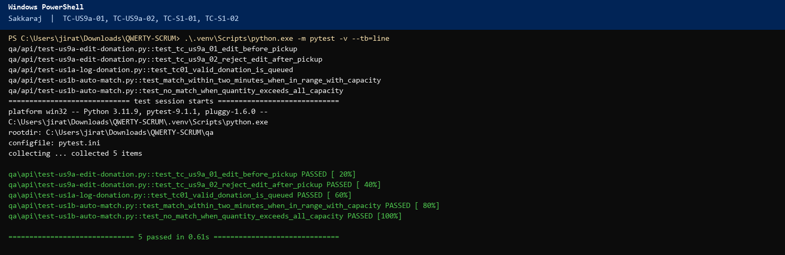

### TC-US9a-03, TC-US9b-06, TC-US9b-07

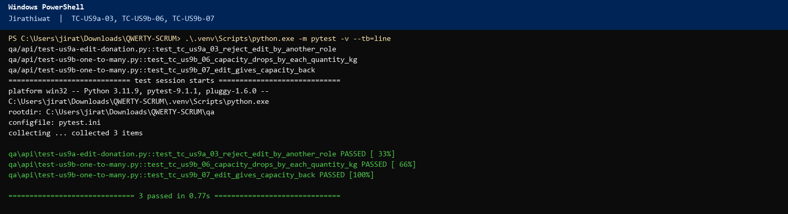

### TC-US9b-01, TC-US9b-02, TC-US9a-04

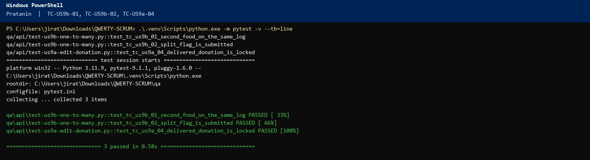

### TC-US9b-03, TC-US9b-04, TC-US9b-05

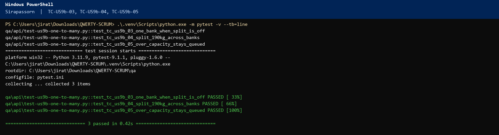

### TC-US3b-01, TC-US3b-02, TC-US3b-03

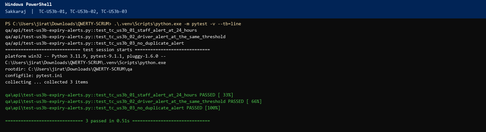

### TC-US3b-04, TC-US4a-01, TC-US4a-02

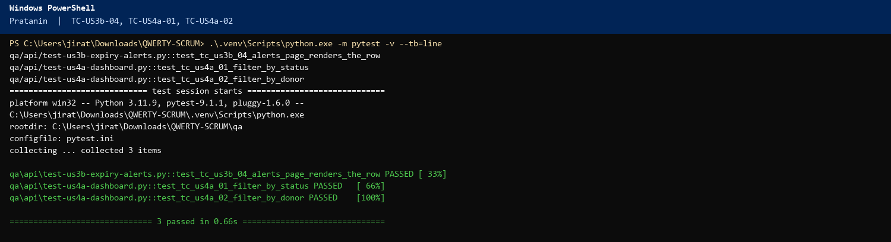

### TC-US4a-03, TC-US4a-04

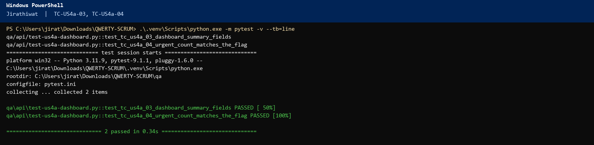

### TC-US4a-05, TC-US4b-05, TC-US5b-03, TC-US7-03, TC-US8-03

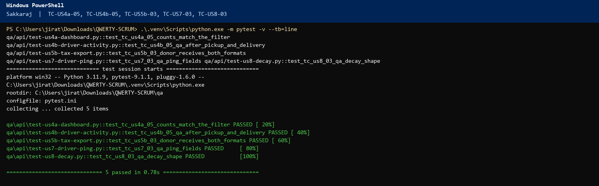

### TC-US4b-01, TC-US4b-02

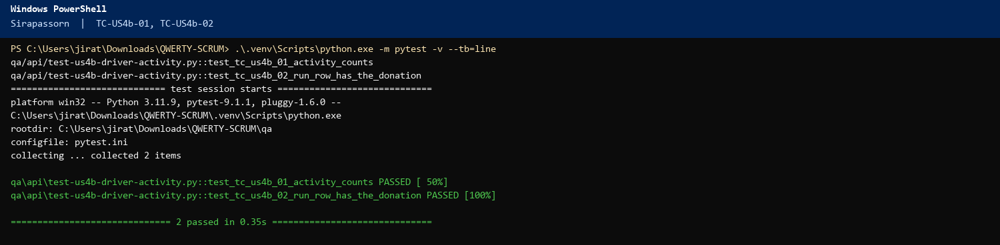

### TC-US4b-03, TC-US5b-02, TC-US7-02

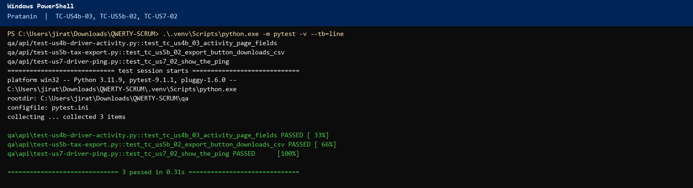

### TC-US4b-04, TC-US7-01

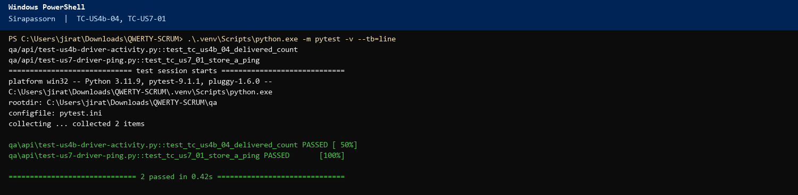

### TC-US5b-01, TC-US8-01, TC-US8-02

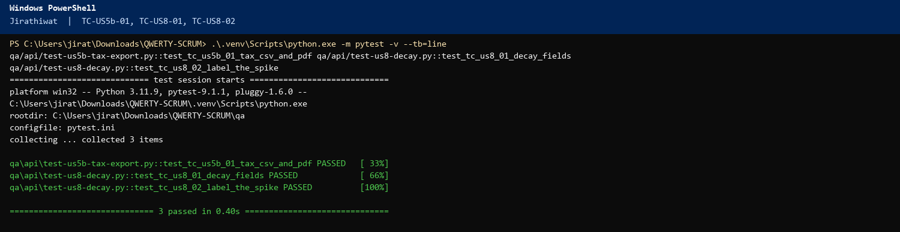

Full suite the same day: `pytest qa/api -q` finished with **60 passed**.
